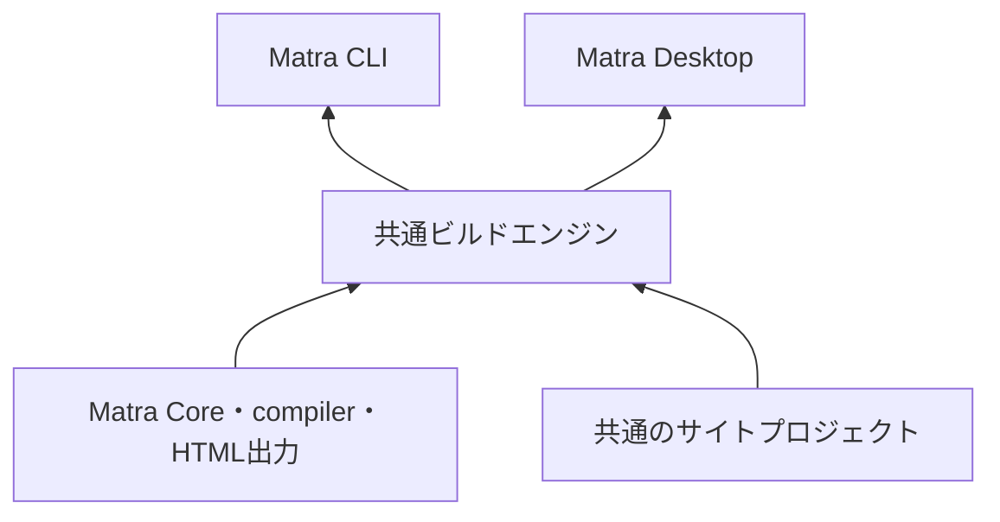

# 共通ビルドエンジンとデスクトップアプリの初期案

[English](./desktop-app.md) | [日本語](./desktop-app.ja.md) | [索引](./README.ja.md)

## 状態

この文書は、Matraのビルド処理をCLIとデスクトップアプリで共通化するための非規範的な初期案です。
未実装であり、名称（共通ビルドエンジン、Matra CLI、Matra Desktop）はすべて仮です。
Matra Program・compiler sourceの文法、compiler ABI、Core・HTMLの公開APIは変更しません。
対応OSや配布形式の正式サポートを宣言するものではありません。
v0.3系では優先度を下げ、着手時期を定めない計画として記録します。v0.3のrelease条件には含めません。

## 目的

Windows・macOS・Linux向けに、共通のコードを中心としたサイト制作ツールを開発します。
CLIのコマンド処理から独立した共通ビルドエンジンを先に設計し、CLIとデスクトップアプリを
その機能を呼び出す二つの入口とします。画面やOSとの連携はデスクトップアプリ側が担います。

CLIの`matra build`とアプリの「ビルド」ボタンは、同じプロジェクトから同じ成果物を生成します。
最初はアプリだけを使っていた人も、後からCLIや自動公開へ移行できることを重視します。

## 「Matraを使って実装する」の三つの意味

| 意味 | 初版での扱い |
| --- | --- |
| Matraで書かれたサイトをビルドする | 共通ビルドエンジンの中心機能 |
| Matraでテンプレート・作例・アプリ内の説明文書を書く | 初版から対象にし、段階的に増やす |
| アプリ全体（編集画面など）をMatraで書く | 初版の前提にしない |

現行のliterate連携は、Promiseや非同期連携、Matra関数をJavaScriptへ渡す機能に対応していません。
編集画面全体までMatraで作ると、GUIに必要な言語・実行機能の開発も同時に抱えることになるため、
アプリ本体はJavaScriptで実装します。

## 共通ビルドエンジン

### 責務

共通化する対象は次のとおりです。CLIとアプリのどちらにも、これらの処理を重複して実装しません。

- プロジェクト作成（テンプレートからの生成）
- 設定の読み込み
- 文書のコンパイル
- HTML・CSS・画像の出力
- 変更監視
- 診断

入出力の表示、引数の解釈、終了コード、ウィンドウ・メニュー・ダイアログはエンジンの責務に含めません。

### 現在の実装との対応

現在の処理は`@matra/cli`の内部に置かれています。

| 現在の場所 | 内容 | エンジンへの移行 |
| --- | --- | --- |
| `packages/cli/src/project.mjs`の`initProject` | テンプレートから`index.md`・`matra.css`・ライセンス・`.gitignore`を生成 | プロジェクト作成としてそのまま移す |
| `packages/cli/src/project.mjs`の`buildProject` | literate APIでcompile・実行し、`dist/`へHTML・CSS・ライセンスを出力 | ビルドとして移し、結果を構造化する |
| `packages/cli/src/dev.mjs`の`startDev` | 入力3ファイルの監視・再build・localhost配信 | 監視と再buildをエンジンへ移し、HTTP配信はCLI側に残す |
| `packages/cli/src/cli.mjs` | 引数解釈・表示・終了コード | CLIの責務として残す |

最初の段階では、既存のCLIの動作・出力・testを維持したまま、処理の置き場所だけを移します。

### APIに求める性質

GUIを早期に接続し、具体的な利用場面に沿って次の性質を設計します。

- **構造化された結果**：成功時は出力ファイルの一覧、失敗時は文字列ではなく診断の配列を返す。
- **診断の位置**：ファイル、行・列、重大度、メッセージを持ち、CLIでは文字列に、アプリではエディターの位置に変換する。
- **進捗通知**：開始・各段階・完了をイベントとして通知する。表示方法は呼び出し側が決める。
- **停止**：`AbortSignal`などで停止を要求できる。現行のcompile・実行は途中で中断できないため、
  初版の確実な停止手段はビルド用プロセスの終了とする。
- **再実行**：変更監視中に保存が続いた場合、実行中のビルドが終わってから最新の状態で一度だけ再ビルドする。
  現行の`startDev`と同じ方針を維持する。
- **出力の安全性**：出力先がsymlinkや想定外の種類のファイルであれば中止する。現行の検査を維持する。

## 共通のサイトプロジェクト

プロジェクトの実体は、通常のフォルダーと文書ファイルです。アプリ専用の保存形式は作りません。
アプリで編集したプロジェクトを、そのままCLI・Git・CIで扱えることを要件とします。

現行のプロジェクトは、`index.md`、`matra.css`、`matra.css.LICENSE`を入力とし、`dist/`へ出力します。
設定ファイルはまだありません。設定ファイルを追加する場合は、エンジンが読み込み、CLIとアプリで同じ値を使います。
アプリのウィンドウ位置や最近開いたプロジェクトなどの利用者ごとの状態は、プロジェクトの外に保存します。

通常のMarkdownの文書データ化・ページデータ・共通レイアウト・ルート出力・外部データ拡張は、
[宣言的サイト生成の追加設計案](./site-generation.ja.md)に分けて記録します。
共通エンジンの後続機能であり、既存CLIの処理移動やDesktop初版の前提条件にはしません。

## Matra Desktop

### 基盤

Electronを想定します。現在のNode.js向けMatra実装を再利用しやすいためです。
Electron同梱のNode.jsで現行Matraが動くかは、初期段階で次の項目を実際に検証します。

- 同梱Node.jsのversionと、CLI配布で固定しているNode.js `24.17.0`との差
- ES modules、`import.meta.resolve`、compiler Wasmの読み込み
- `@matra/core/experimental/literate`による文書のcompile・実行
- パッケージ後（asar内を含む）のテンプレート・CSS・compiler Wasmへのアクセス

### プロセス構成

| プロセス | 役割 |
| --- | --- |
| main | ウィンドウ・メニュー・ダイアログ・ファイル選択、ビルド用プロセスの起動と停止 |
| ビルド用プロセス | 共通ビルドエンジンの実行（Electronの`utilityProcess`などNode.jsを使える別プロセス） |
| 編集画面（renderer） | ファイル一覧・ソース編集・エラー表示。限定したIPCだけを使う |
| プレビュー | 生成したサイトの表示 |

ビルドは画面とは別のプロセスで動かします。長い処理中も編集画面を操作でき、停止・再実行を扱いやすくするためです。

### セキュリティの方針

- プレビューするサイトには、アプリ自身のファイル操作機能やIPCを渡さない。preloadを与えず、Node.js統合を無効にする。
- 編集画面もNode.js統合を無効にし、context isolationとsandboxを有効にして、必要な操作だけをpreloadで公開する。
- ビルドでは文書内のJavaScriptがNode.jsの権限で実行される。CLIと同じく、信頼する文書だけをビルドすることを画面上でも明示する。
- プレビューから外部へのナビゲーションや新規ウィンドウの作成は、既定で拒否するか外部ブラウザーへ渡す。

### 初版の範囲

初版は次の機能で、意味のある制作ツールとして成立させます。

- プロジェクトを開く・新規作成する
- ファイル一覧
- ソース編集と保存
- ビルドとプレビュー
- エラー表示（診断の位置へ移動できること）
- サイトの書き出し

ドラッグ操作によるページ編集、公開先への自動デプロイは初版に含めず、
この上に追加します。

## 配布

インストーラーの生成には、当初はElectron Forgeなどの既存ツールを利用します。
既存のCLI配布（Node.js同梱のフォルダー・ZIP）は、デスクトップアプリとは別の配布物として維持します。
OS・CPU・最低対応バージョンを定め、インストールから起動・ビルド・プレビューまでを3 OSで継続して確認します。
コード署名・公証は、未実施であることを明示したうえで別途扱います。

## 開発順

CLIをすべて完成させてからGUIに着手する必要はありません。

| 段階 | 作業 | 完了の証拠 |
| --- | --- | --- |
| 1：共通エンジンと最小CLI | 現在の`project.mjs`・`dev.mjs`の処理をエンジンへ移し、CLIをその上に載せる | 既存のCLI testの成功、プロジェクト作成からHTML出力までのエンジン単体test |
| 2：最小デスクトップアプリ | Electron同梱Node.jsでの動作検証、「開く→編集→保存→ビルド→プレビュー」の接続 | 検証項目の結果、各操作の自動または手動の確認記録 |
| 3：両方での検証 | 同じプロジェクトをアプリとCLIでビルドし、成果物と診断を比較 | 同一入力から同じ`dist/`、同じ診断の位置を得るtest |
| 4：3 OSの配布 | OS・CPU・最低対応バージョンを定め、配布物を継続して生成・検証 | CIでの生成、インストールから動作までの確認記録 |

GUIを早期に接続することで、エンジン側に必要な進捗通知、停止、エラー位置などを具体的に設計します。

## 未決事項

- 製品名と、共通ビルドエンジンのpackage名・公開範囲
- 設定ファイルの有無・形式・置き場所
- 診断と進捗イベントのデータ形式
- 採用するElectronのversionと更新方針
- 画像など、現行の3ファイル以外の入力・出力の扱い
- 編集画面に用いるエディター部品
