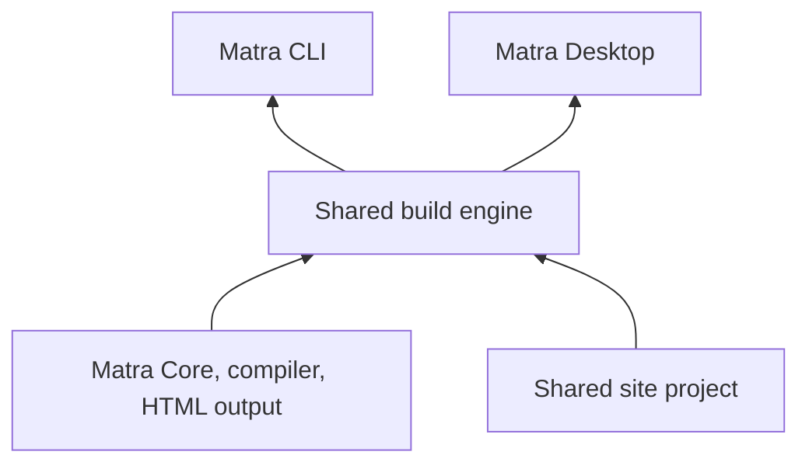

# Initial proposal for a shared build engine and desktop app

[English](./desktop-app.md) | [日本語](./desktop-app.ja.md) | [Index](./README.md)

## Status

This is a non-normative initial proposal for sharing Matra's build processing between the CLI and a desktop app.
Nothing here is implemented yet, and all names (shared build engine, Matra CLI, Matra Desktop) are provisional.
It changes neither Matra Program nor compiler source grammar, the compiler ABI, or the Core/HTML public APIs.
It does not declare formal support for any OS or distribution format.
It is deprioritized in the v0.3 series and recorded as a plan with no scheduled start; it is not part of the v0.3 release criteria.

## Purpose

Build a site-authoring tool for Windows, macOS, and Linux centered on shared code.
Design a shared build engine independent of CLI command handling first, and treat the CLI and the desktop app
as two entry points that call it. The desktop app owns UI and OS integration.

`matra build` in the CLI and the Build button in the app produce the same output from the same project.
A person who starts with only the app can later move to the CLI or automated publishing.

## Three meanings of "implementing with Matra"

| Meaning | Treatment in the first version |
| --- | --- |
| Building sites written in Matra | Core function of the shared build engine |
| Writing templates, examples, and in-app help in Matra | In scope from the first version and expanded gradually |
| Writing the whole app (including the editor UI) in Matra | Not a premise of the first version |

The current literate integration does not support Promises, asynchronous integration, or passing Matra functions
to JavaScript. Writing the entire editor in Matra would mean developing the language and runtime features a GUI
needs at the same time, so the app itself is implemented in JavaScript.

## Shared build engine

### Responsibilities

The following are shared. Neither the CLI nor the app reimplements them.

- Project creation (generation from templates)
- Loading configuration
- Compiling documents
- Writing HTML, CSS, and images
- Watching for changes
- Diagnostics

Presentation, argument parsing, exit codes, and windows, menus, and dialogs are not engine responsibilities.

### Mapping from the current implementation

The current processing lives inside `@matra/cli`.

| Current location | Contents | Move to the engine |
| --- | --- | --- |
| `initProject` in `packages/cli/src/project.mjs` | Generates `index.md`, `matra.css`, its license, and `.gitignore` from the template | Move as project creation |
| `buildProject` in `packages/cli/src/project.mjs` | Compiles and runs via the literate API and writes HTML, CSS, and license to `dist/` | Move as build and return structured results |
| `startDev` in `packages/cli/src/dev.mjs` | Watches three input files, rebuilds, and serves on localhost | Move watching and rebuilding; keep HTTP serving in the CLI |
| `packages/cli/src/cli.mjs` | Argument parsing, output, exit codes | Remains the CLI's responsibility |

The first stage only relocates the processing while preserving the existing CLI behavior, output, and tests.

### Required API properties

Connecting the GUI early lets these properties be designed around concrete use.

- **Structured results**: on success return the list of output files; on failure return an array of diagnostics rather than a string.
- **Diagnostic locations**: file, line/column, severity, and message, rendered as text by the CLI and mapped to editor positions by the app.
- **Progress events**: report start, each phase, and completion as events. Callers decide how to display them.
- **Cancellation**: accept a cancellation request such as an `AbortSignal`. Current compile and execution cannot be
  interrupted midway, so in the first version the reliable way to stop is to terminate the build process.
- **Re-runs**: when saves continue during watching, rebuild once with the latest state after the running build
  finishes, keeping the current `startDev` policy.
- **Output safety**: abort if an output path is a symlink or an unexpected file type, keeping the current checks.

## Shared site project

A project is an ordinary folder of document files. No app-specific save format is introduced.
A project edited in the app must be usable as-is with the CLI, Git, and CI.

The current project takes `index.md`, `matra.css`, and `matra.css.LICENSE` as input and writes to `dist/`.
There is no configuration file yet. If one is added, the engine reads it and the CLI and app use the same values.
Per-user app state such as window position or recent projects is stored outside the project.

## Matra Desktop

### Platform

Electron is assumed because it makes reusing the current Node.js-based Matra implementation easy.
Whether current Matra runs on Electron's bundled Node.js is verified early on the following items.

- The bundled Node.js version and its difference from Node.js `24.17.0` pinned in the CLI distribution
- ES modules, `import.meta.resolve`, and loading the compiler Wasm
- Compiling and running documents via `@matra/core/experimental/literate`
- Access to templates, CSS, and compiler Wasm after packaging (including inside asar)

### Process layout

| Process | Role |
| --- | --- |
| main | Windows, menus, dialogs, file selection; starting and stopping the build process |
| Build process | Runs the shared build engine (a separate Node.js-capable process such as Electron's `utilityProcess`) |
| Editor (renderer) | File list, source editing, error display; uses only a limited IPC surface |
| Preview | Displays the generated site |

Builds run in a process separate from the UI so the editor stays usable during long builds and stopping and
re-running are easy to handle.

### Security policy

- The previewed site gets none of the app's file operations or IPC: no preload and Node.js integration disabled.
- The editor also disables Node.js integration, enables context isolation and the sandbox, and exposes only
  the needed operations through a preload.
- Building runs JavaScript in the document with Node.js privileges. As with the CLI, the UI states that only
  trusted documents should be built.
- Navigation to external sites and new windows from the preview are denied by default or handed to the external browser.

### First-version scope

The first version is a meaningful authoring tool with the following features.

- Open or create a project
- File list
- Source editing and saving
- Build and preview
- Error display (with navigation to diagnostic locations)
- Site export

Drag-based page editing and automated deployment are not in the first version and are added on top later.

## Distribution

Installers are initially produced with existing tools such as Electron Forge.
The existing CLI distribution (folders/ZIPs bundling Node.js) remains a separate artifact from the desktop app.
OS, CPU, and minimum supported versions are decided, and installation through launch, build, and preview is
checked continuously on all three OSes. Code signing and notarization are handled separately and stated as not done.

## Development order

There is no need to finish the CLI before starting the GUI.

| Stage | Work | Evidence of completion |
| --- | --- | --- |
| 1: Shared engine and minimal CLI | Move the processing in `project.mjs` and `dev.mjs` into the engine and put the CLI on top | Existing CLI tests pass; engine tests from project creation to HTML output |
| 2: Minimal desktop app | Verify Electron's bundled Node.js; connect open → edit → save → build → preview | Results of the verification items; automated or manual records of each operation |
| 3: Validation with both | Build the same project in the app and the CLI and compare output and diagnostics | Tests showing the same `dist/` and diagnostic locations from the same input |
| 4: Distribution on three OSes | Decide OS, CPU, and minimum versions; generate and verify artifacts continuously | Generation in CI; records from installation to operation |

Connecting the GUI early lets the engine's progress events, cancellation, and error locations be designed concretely.

## Open questions

- Product names, and the package name and publication scope of the shared build engine
- Whether a configuration file exists, and its format and location
- Data formats for diagnostics and progress events
- Electron version and update policy
- Handling inputs and outputs beyond the current three files, such as images
- Editor component used in the app
